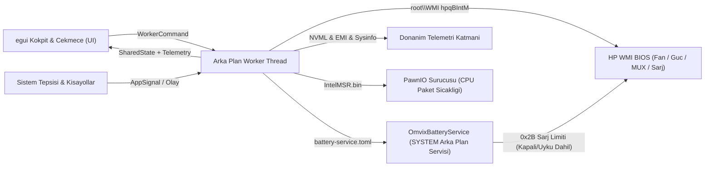
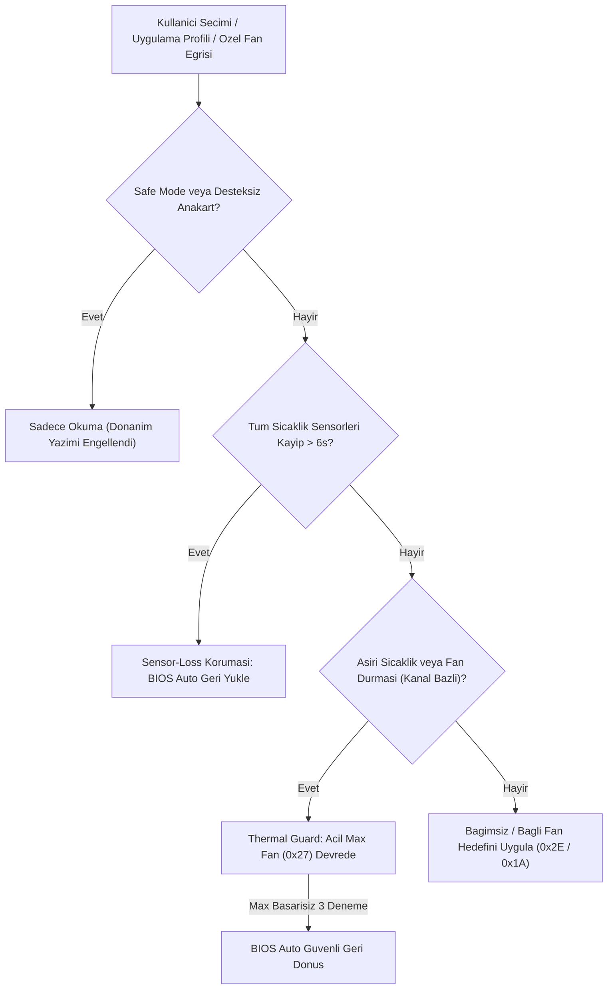

# Omvix Hub (`v0.7.0`)

**HP Victus & OMEN** dizüstü bilgisayarlar için **Rust** ile geliştirilmiş; hafif, telemetrisiz (sıfır telemetry/bulut bağlantısı), güvenli donanım koruma katmanlarına sahip performans, bağımsız CPU/GPU fan, batarya sağlığı, klavye aydınlatma ve ekran kontrol merkezi.

> [!NOTE]
> HP OMEN Gaming Hub'ın ağır arka plan servislerine alternatif olarak tasarlanmıştır. Tüm kritik BIOS çağrıları salt-okunur doğrulama, anakart uyumluluk kapısı (Board Allowlist) ve otomatik termal güvenlik korumaları ile sarmalanmıştır.

---

## İçindekiler

- [Öne Çıkan Özellikler](#öne-çıkan-özellikler)
- [Kurulum ve İlk Çalıştırma (Nasıl Kullanılır?)](#kurulum-ve-i̇lk-çalıştırma-nasıl-kullanılır)
- [Ana Kokpit ve Yan Çekmece (Drawer) Rehberi](#ana-kokpit-ve-yan-çekmece-drawer-rehberi)
- [Sistem Mimarisi ve Güvenlik Akışı](#sistem-mimarisi-ve-güvenlik-akışı)
- [Güvenlik Katmanları Özeti](#güvenlik-katmanları-özeti)
- [Kısayollar ve Otomatik Profiller](#kısayollar-ve-otomatik-profiller)
- [CLI Kullanımı (`omvix-cli.exe`)](#cli-kullanımı-omvix-cliexe)
- [Dosya Yolları ve Acil Kurtarma (Recovery)](#dosya-yolları-ve-acil-kurtarma-recovery)

---

## Öne Çıkan Özellikler

- **Minimal G-Helper Tarzı Kokpit:** Tek pencerede Performans Modu, bağımsız/bağlı CPU & GPU fan kontrolü, hızlı CPU Boost & Hz seçimi, Batarya Şarj Limiti, 4 bölgeli Klavye RGB aydınlatma ve canlı CPU/GPU sıcaklık/RPM göstergeleri.
- **Bağımsız Çift Fan Kontrolü (CPU & GPU):** CPU ve GPU fanları için ayrı **Otomatik**, **Maksimum**, **Sabit %** ve **8 Noktalı Özel Eğri** desteği (`0x2E [CPU, GPU]`) ve isteğe bağlı **Fanları Bağla** anahtarı.
- **Otonom Batarya Bakımı ve Arka Plan Servisi:** `60%` Masaüstü, `80%` Dengeli, `90%` Seyahat veya özel eşikler, tek seferlik **%100 Seyahat Şarjı** (otomatik zaman/dolum sıfırlamalı), uyku/kapanmada **Kilitli Beklet (`Hold`)** ve uygulama kapalıyken çalışan **OmvixBatteryService**.
- **Gelişmiş Tema & Görünüm Motoru:** Hazır koyu/açık/yüksek kontrast temalar, 12 renkli özel tema paleti, köşe yuvarlaklığı (`card_radius`, `control_radius`) ve çerçeve kalınlığı ayarları, `OMVIX2|...` tema paylaşım kodları.
- **Otomasyon:** Priz/Pil (AC/DC) geçiş profilleri ve `.exe` algılamalı Uygulama Profilleri.

---

## Kurulum ve İlk Çalıştırma (Nasıl Kullanılır?)

### 1. İndirme
[GitHub Releases](https://github.com/Borab55/omvix-hub/releases) sayfasından son sürüm ZIP arşivini indirin ve sabit bir klasöre çıkarın (örneğin `C:\Apps\OmvixHub\`). Arşiv tek başına taşınabilir (portable) `omvix-hub.exe` ve `omvix-cli.exe` içerir; ek DLL veya runtime kurulumu gerekmez.

### 2. İlk Çalıştırma ve Yönetici İzni
1. `omvix-hub.exe` dosyasını **Yönetici Olarak Çalıştır** seçeneğiyle başlatın (HP WMI BIOS donanım kontrolleri Windows'ta Yönetici yetkisi gerektirir).
2. İlk açılışta **İlk Kurulum Sihirbazı** karşılar:
   - **Adım 1:** Dil seçimi (`Türkçe` / `English`) ve güvenlik özeti.
   - **Adım 2:** Çakışan yazılımların (ör. OMEN Gaming Hub arka plan servisleri) kontrolü.
   - **Adım 3:** İsteğe bağlı Windows ile otomatik başlatma (yönetici UAC sormayan Zamanlanmış Görev desteği) ve Sistem Tepsisi (Tray) ayarları.
   - **Adım 4:** İsteğe bağlı `OmvixBatteryService` kurulumu — uygulama kapalıyken veya bilgisayar uyku/kapalı durumdayken de batarya şarj limitini korur.

### 3. Günlük Kullanım
- Pencere sağ alt köşeye sabitlenebilir; dışarı tıkladığınızda otomatik olarak **Sistem Tepsisi'ne** gizlenir.
- **Tepsi İkonu** üzerinden tek tıkla pencereyi açıp kapatabilir, sağ tık menüsüyle Performans Modu, Fan Modu ve Batarya Limitini değiştirebilirsiniz.
- Varsayılan genel kısayol **`Ctrl+Shift+O`** ile (veya OMEN tuşuyla) pencereyi her yerden çağırabilirsiniz.

---

## Ana Kokpit ve Yan Çekmece (Drawer) Rehberi

Ana kokpitin alt kısmındaki 4 sekme, kokpitin solunda açılan detay çekmecesini kontrol eder:

| Bölüm / Sekme | Ne İşe Yarar? | Öne Çıkan Ayarlar |
| :--- | :--- | :--- |
| **Kokpit (Ana Pencere)** | Günlük tek bakışta kontrol | Performans Modu (Sessiz / Dengeli / Performans), CPU/GPU Sıcaklık & RPM, Fan & Şarj Hızlı Kutucukları, Klavye RGB & Parlaklık (harici `Fn` tuşlarıyla yapılan değişiklikleri otomatik algılar), Geri Al / Gizle / Çıkış, Versiyona tıklayınca Güncelleme Kontrolü |
| **Grafikler** | Canlı sistem izleme & kayıt | CPU/GPU yükü ve sıcaklığı, kasa sıcaklığı, paket/GPU gücü (EMI & NVML), RAM, Disk/Ağ I/O, CSV dışa aktarma |
| **Fan + Güç -> CPU** | İşlemci gücü & fan eğrisi | Windows Güç Modu senkronizasyonu, CPU Turbo Boost, PL1 / PL2 Watt sınırları (BIOS varsayılanına sıfırlama dahil), CPU 8 noktalı fan eğrisi & histerezis |
| **Fan + Güç -> GPU** | Ekran kartı & ikinci fan | RTX GPU saat hızları, VRAM & termal kısma durumu, bağımsız GPU 8 noktalı fan eğrisi, BIOS MUX Grafik Modu (Hybrid / Discrete / Optimus) |
| **Fan + Güç -> Profiller** | Otomatik kural motoru | Priz/Pil (AC/DC) profilleri, çalışan `.exe` bazlı uygulama profilleri (çıkışta eski ayarları otomatik geri yükleme) |
| **Batarya** | Pil sağlığı & servis kontrolü | `60%` / `80%` / `90%` / `100%` profilleri, özel batarya profili oluşturma, Tek Seferlik %100 Şarj, Pil Sağlığı geçmiş grafiği, `OmvixBatteryService` yönetimi |
| **Ekstra -> Görünüm & Tema** | Arayüz kişiselleştirme | Hazır & kayıtlı özel temalar, 12 renk editörü, kart/buton köşe yuvarlaklığı & çerçeve kalınlığı, yazı tipi ölçeği (%85–%130), Yüksek Kontrast |
| **Ekstra -> Aydınlatma & Ekran** | RGB & Panel yenileme | 4 bölgeli klavye RGB profil kütüphanesi, harici `Fn` klavye/panel/güç modu senkronizasyonu ve desteklenen ekran yenileme hızı (`60Hz` / `144Hz` / `165Hz` vb.) |
| **Ekstra -> Kısayollar** | Tuş atamaları | OMEN tuşu davranışı, Genel pencere kısayolu (`Ctrl+Shift+O` vb.) canlı tuş kombinasyonu yakalama, özel uygulama başlatma |
| **Ekstra -> Tanılama & Geçmiş** | Sorun giderme & Geri Al | Son 10 donanım değişikliği ve tek tık **Geri Al (Undo)**, salt-okunur WMI donanım kontrolleri, JSON dışa aktarma, Destek Paketi (`.zip`) |
| **Ekstra -> Ayarlar** | Sistem & Güncellemeler | Dil, başlangıç davranışı, log seviyesi & boyut limiti, GitHub release güncelleme kontrolü (SHA-256 doğrulamalı), PawnIO CPU sensör kurulumu |

---

## Sistem Mimarisi ve Güvenlik Akışı

### Genel Mimari ve Yetki Ayrımı



### Termal Güvenlik ve Fan Karar Akışı



---

## Güvenlik Katmanları Özeti

| Koruma Katmanı | Tetiklenme Koşulu | Uygulanan Güvenli Davranış |
| :--- | :--- | :--- |
| **Board Allowlist Kapısı** | Doğrulanmamış anakart Kimliği (Board ID) | Ayarlardan kullanıcı açıkça Deneysel Mod'u onaylamadıkça yazma komutlarını engeller; kurtarma (`Auto`) komutları her zaman açık kalır. |
| **Thermal Safety Guard** | CPU/GPU/Kasa aşırı ısınması veya aktif yüklü fan kanalının `1800 RPM` altına düşmesi | Zorunlu **Acil Max Fan** devreye alır ve sıcaklık düşene kadar manuel fan düşürme isteklerini engeller. Fan hızı artmazsa 3 denemeden sonra BIOS `Auto`'ya döner. |
| **Sensor-Loss Guard** | Tüm sıcaklık sensörlerinin `> 6 saniye` boyunca okunamaması | Özel eğri/manuel mod kör kalmasın diye fanları anında BIOS `Auto` kontrolüne geçirir, sensörler gelince kullanıcı moduna döner. |
| **Crash-Loop Safe Mode** | Ardışık 3 başlatmada donanım yazımından sonraki `60 saniye` içinde çökme (veya başlangıçta **`Shift`** / `--safe-mode`) | Uygulamayı salt-okunur **Safe Mode**'da açar; hiçbir donanım/WMI ayarı yazılmaz. |
| **BIOS Fan Keep-Alive** | HP BIOS'un ~120 saniyelik manuel fan zaman aşımı | Etkin özel/manuel fan modlarında sessiz periyodik tazeleme göndererek fanların beklenmedik şekilde düşmesini önler. |
| **DLL & Güncelleme Sertleştirme** | Başlatma ve güncelleme aşaması | `SetDefaultDllDirectories(System32)` uygular; güncellemeleri yalnızca sabit GitHub repo hostlarından indirir ve SHA-256 + Authenticode ile doğrular. |

---

## Kısayollar ve Otomatik Profiller

- **Priz / Pil (AC/DC) Otomasyonu:** Şarj kablosu takıldığında veya çıkarıldığında performans modunu, fan modunu/eğrisini, ekran Hz değerini (`165Hz -> 60Hz`) ve klavye aydınlatmasını otomatik değiştirir.
- **Uygulama (`.exe`) Profilleri:** Üstten alta öncelik sırasıyla çalışan oyun/uygulama `.exe` dosyalarını takip eder. Uygulama kapandığında **2 ardışık kontrol (debounce)** sonrasında önceki kullanıcı temel ayarlarını (CPU & GPU fan dahil) otomatik geri yükler.
- **Genel Kısayol & OMEN Tuşu:** Ayarlar -> Kısayollar altından tek tuş kombinasyonuyla (`Ctrl+Shift+A` vb.) pencereyi aç/gizle veya özel `.exe`/kısayol çalıştır.
- **Harici Donanım Değişikliği Algılama:** Dizüstünün kendi `Fn` ışık kısayollarıyla yapılan klavye arka aydınlatma kapatma/açma ve renk değişiklikleri (`0x20009` salt-okunur doğrulama + `hpqBEvnt` olayı / düşük maliyetli periyodik kontrol), ekran Hz, CPU Turbo Boost ve Windows Güç Modu değişiklikleri otomatik algılanıp arayüze ve ayarlara (`config.toml`) yansıtılır; uyku dönüşü veya priz profili geçişlerinde harici kapatılan ışık zorla geri açılmaz.
- **Eski `Eco` Ayar Uyumluluğu:** `Eco` ve `Sessiz` (`Quiet`) tek **Sessiz** modunda birleştirilmiştir; eski `config.toml` dosyalarındaki `"Eco"` değerleri hata vermeden otomatik olarak `Quiet` olarak yüklenir.

---

## CLI Kullanımı (`omvix-cli.exe`)

Donanım teşhisi, batarya durumu ve acil sıfırlama komutları için terminalden kullanılabilir:

```powershell
# Salt-okunur donanım kontrolü ve anakart raporu
omvix-cli.exe probe
omvix-cli.exe export-diagnostics --out C:\Temp\diag.json

# Canlı CPU / GPU / Fan / Batarya telemetrisi ve log bilgileri
omvix-cli.exe telemetry
omvix-cli.exe logs-path
omvix-cli.exe display list
omvix-cli.exe tuning status

# Yönetici yetkili donanım kontrolleri
omvix-cli.exe thermal set balanced       # quiet | balanced | performance
omvix-cli.exe fan set max                # auto | max
omvix-cli.exe fan set manual --speed 65  # 0..100 (sadece manual modunda)
omvix-cli.exe battery status
omvix-cli.exe battery set-mode inhibit   # auto | inhibit | hold

# Hızlı güvenli fabrika moduna dönüş (Acil Kurtarma)
omvix-cli.exe fan set auto
omvix-cli.exe battery auto
```

---

## Dosya Yolları ve Acil Kurtarma (Recovery)

| Tür | Konum |
| :--- | :--- |
| **Kullanıcı Ayarları (`config.toml`)** | `%APPDATA%\OmvixHub\config.toml` |
| **Çökme Koruması (`crash_guard.json`)** | `%APPDATA%\OmvixHub\crash_guard.json` |
| **Pil Sağlığı Geçmişi** | `%APPDATA%\OmvixHub\battery_history.json` |
| **Uygulama Logları (Dönen Dosyalar)** | `%LOCALAPPDATA%\OmvixHub\logs\omvix.log` (`omvix.1.log` ...) |
| **Arka Plan Servis Konumu** | `C:\Program Files\OmvixHub\` ve `C:\ProgramData\OmvixHub\` |

### Acil Kurtarma Adımları
Herhangi bir ayardan sonra sorun yaşarsanız:
1. Açılışta klavyeden **`Shift`** tuşunu basılı tutarak veya `omvix-hub.exe --safe-mode` komutuyla **Güvenli Mod**'da başlatın.
2. Veya yönetici PowerShell üzerinden anında BIOS kontrolünü geri yükleyin:
   ```powershell
   omvix-cli.exe fan set auto
   omvix-cli.exe battery auto
   ```
3. Tüm yazılım ve donanım ayarlarını fabrika durumuna çevirmek için **Ekstra -> Ayarlar -> Tüm Varsayılanları Geri Yükle** butonunu kullanabilirsiniz (kurulu servis ve başlangıç görevi de temizlenir).
